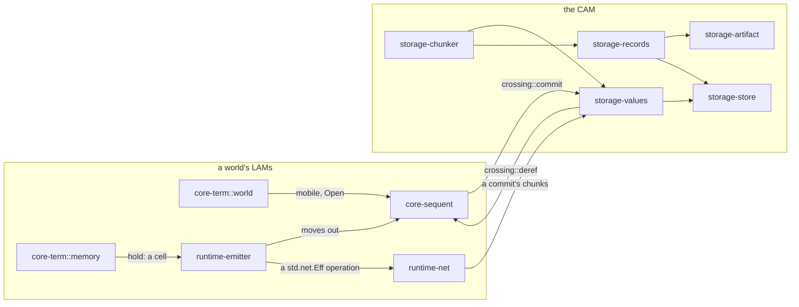

# crates

This file is the naming authority for the workspace's crates. A crate lives at `crates/<category>-<name>` and its package is `gandr-<category>-<name>`; the driver's row names the one exception, and its README gives the reason.

Three disciplines: consult this file before naming a crate; when it is silent, derive the name from the layering below and the crates beside it; add the row to its category's file in the same change that adds the crate. A divergence is recorded here, not smoothed over.

## Layering

Categories are a layering order: a crate depends only on crates of its own category or of one listed before it. The categories are also the closed vocabulary of commit scopes.

```text
theory    reusable metatheory machinery
kernel    the certified trusted base and its substrate: levels, the term arena and sharing format, the checking machine
core      the core language: call-by-push-value syntax, the unified context, normalization by evaluation
storage   the content-addressed tier: authenticated record and value planes
runtime   effectful host machinery below the faces: effects handlers, foreign calls, emitted native code
surface   syntax, grammar, parsing, lowering, the pipeline a driver invocation enters, and the driver a human or a tool runs
workflow  repository tooling and gates
```

## Map

The category map is [`ledger/README.md` § Map](../ledger/README.md#map), and the per-crate map is [`ledger/crates.dot`](../ledger/crates.dot).

## Members

One file for each category holds its member rows: one row for each directory, the directory and what it is. `check:crate-map` refuses a crate with no row, a row with no crate, a row in another category's file, and a count below that differs from its file.

- [`theory`](README/theory.md): 25 crates
- [`kernel`](README/kernel.md): 6 crates
- [`core`](README/core.md): 12 crates
- [`storage`](README/storage.md): 6 crates
- [`runtime`](README/runtime.md): 3 crates
- [`surface`](README/surface.md): 28 crates
- [`workflow`](README/workflow.md): 12 crates

The policy library and the gate binary are not members: they come from [quenchant](https://github.com/gandr-lang/quenchant) at the revision the root `Cargo.toml` pins.

A crate README's shape is [`ledger/README.md` § Crate READMEs](../ledger/README.md#crate-readmes).

The compilation model of a program is § Compilation of [`surface-evaluate`'s crate documentation](surface-evaluate/src/lib.rs).

## Storage and distribution

The storage crates form the content-addressable CAM. Runtime stores form location-addressable LAMs. Each world has its own LAMs and reaches one logical CAM by canonical-byte digest. A digest proves integrity. The checker and kernel decide validity. The v1 storage vectors define the external contract (`Rainey-2026-localmem_typedirected_adaptive_serialization_location_contentaddressable_memory`). Their sharing points are the `sharing` concern of `ledger/concerns.sql`.



| Crate | Layer | Located | Resident | Wall |
| ----- | ----- | ------- | -------- | ---- |
| `storage-chunker` | CAM | none | cut points, κ and cap committed | integrity |
| `storage-values` | CAM | none | a typed chunk DAG of `ContentPtr`s | integrity |
| `storage-records` | CAM | none | records under a `TreeRoot` | integrity |
| `storage-artifact` | CAM | none | a kernel artifact as records | integrity, then validity |
| `storage-store` | CAM | one host's directory; its roots never cross | chunks, nodes and named roots, a file each | integrity |
| `runtime-emitter` | LAM | its thread | a run's regions | validity |
| `runtime-net` | LAM | its process | a stream's frames; served chunks | integrity |
| `core-sequent` | LAM | its run | the `Store`, append-only | none |
| `core-term::world` | world | `⊢_w`, `A at w` | — | validity |
| `core-term::memory` | LAM | a hold's world | a held cell lent to a view | validity |

## Divergences

None.
