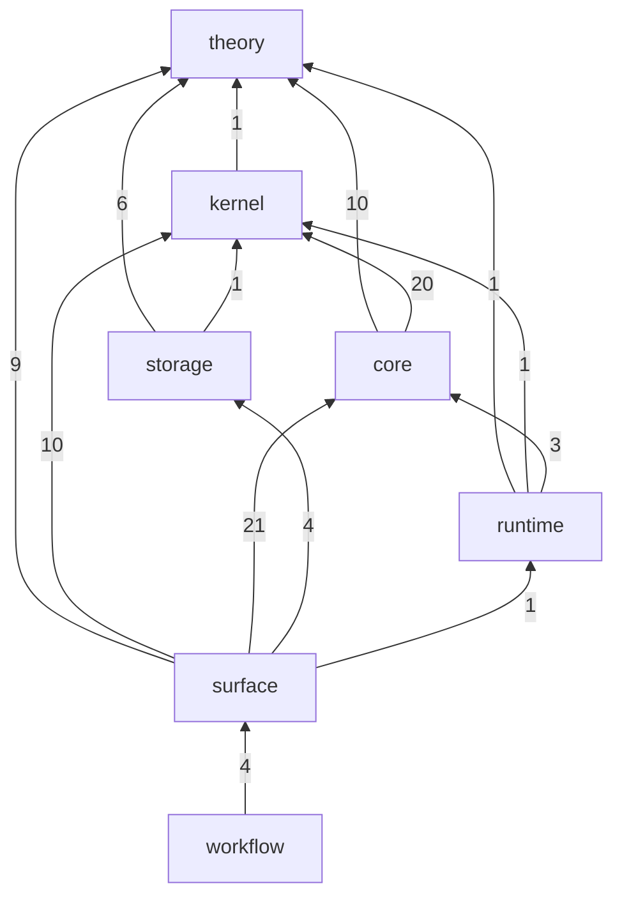

# crates

This file is the naming authority for the workspace's crates. A crate lives at `crates/<category>-<name>` and its package is `gandr-<category>-<name>`; the driver is the one exception, package `gandr-lang`, the name the project holds on the registry, where `gandr` belongs to an unrelated crate.

Three disciplines: consult this file before naming a crate; when it is silent, derive the name from the layering below and the crates beside it; add the row in the same change that adds the crate. A divergence is recorded here, not smoothed over.

## Layering

Categories are a layering order: a crate depends only on crates of its own category or of one listed before it. The categories are also the closed vocabulary of commit scopes.

```text
theory    reusable metatheory machinery
kernel    the certified trusted base and its substrate: levels, the term arena and sharing format, the checking machine
core      the core language: call-by-push-value syntax, the unified context, normalization by evaluation
storage   the content-addressed tier: authenticated record and value planes
runtime   effectful host machinery below the faces: effects handlers, foreign calls, emitted native code
surface   syntax, grammar, parsing, lowering, the pipeline a driver invocation enters, and the driver a human or a tool runs
workflow  repository tooling and gates
```

## Map

An arrow is one category's dependencies on another. Its label counts the `[dependencies]` edges between their crates. Dev and build dependencies are not counted. The per-crate map is [`ledger/crates.dot`](../ledger/crates.dot), one node per crate, clustered by category. `mise run ledger:crate-map` generates both from `cargo metadata`. `mise run check:crate-map` fails while either is stale, while a crate lies outside the layering's categories, or while an edge points to a category listed after its own. A change that adds a crate or an edge between two crates regenerates the map in the same commit, so its diff shows the new edge.

<!-- crate-map:begin -->

<!-- crate-map:end -->

## Members

One row per directory: the directory and what it is. The package name follows from the directory by the rule above.

```text
# Rows sort lexicographically by directory; the dependency order is § Layering.
crates/
├── core-checker/                  the checking judgement's four directed faces, the declaration input, the conversion boundary, the obligation ledger, the refusal vocabulary, residual readmission and guarded staging families
├── core-incremental/              incremental checking: the item seam, the conservative footprint, validated resume, content-addressed checkpoints and the synthesis stream
├── core-nbe/                      the glued value domain, evaluation, readback, conversion and native path transport; the sharing overlay, its erasure and its measure; strict meta-level staging
├── core-sequent/                  the command IL a core program is focused into, the outcome a run answers in and the store its answer is read back from
├── core-session/                  contractive binary session types, coinductive relation search, endpoint replay, dialogue admission by logical time and certified recorded-run transport
├── core-term/                     core syntax with native universe paths, the one unified context and the co-de Bruijn carrier
├── core-unify/                    contextual metavariables and their unifier: most general solutions only, one store of postponed equations woken by their blockers, refutation on stable evidence
├── kernel-check-memo/             the check-memo seam a checker consults
├── kernel-conversion-trace/       the conversion-decision vocabulary and its sink
├── kernel-core/                   checking, conversion, admission and memoization; Path_U, identity and bridge recursion, higher fields, funext, Flow_U, guarded List observations and session-certificate replay; stage formation and replay
├── kernel-strata/                 the universe-level oracle with checkable order evidence
├── kernel-term/                   the term arena, native universe paths, Empty, List and session codes, hypothesis-indexed stage syntax, the sharing format and decode budgets
├── runtime-emitter/               the L machine's commands lowered and copy-and-patched into native code under a content cache, or built for the portable executor, and each outcome moved into the caller's store
├── runtime-stencils/              the L machine's transitions written once: the stencils the emitter copies and patches, and the portable executor that dispatches them
├── storage-artifact/              kernel artifacts on the record plane and canonical BLAKE3 certificate-step identities
├── storage-chunker/               content-defined chunk boundaries and their committed parameters
├── storage-records/               the authenticated ordered-record plane
├── storage-schema/                the record plane as C-sets with checked equations
├── storage-values/                the content-addressed value plane: typed chunk DAG and content pointers
├── surface-corpus/                the expectation schemas, the strict and fixture roots, the settle comparison, the runner's report shape, and the language's corpus
├── surface-diagnostics/           the diagnostics model: a refusal, an unsettled declaration, a goal, a warning and a ledger line built once, with their loci and the rules a refusal stood inside, for every face to project
├── surface-dispatcher/            routes a driver invocation; composes parse, lower, check and settle over the sources a verb walks
├── surface-driver/                the `gandr` driver binary, package `gandr-lang`: `check`, `test`, `run`, `fmt`, `stage`, `lsp`, `serve`, `mcp`, `view`, `repl`, `tui` and the exit codes
├── surface-format/                the source formatter: a parsed source laid out at a page width, its tokens and comments kept and its meaning checked unchanged
├── surface-grammar/               the checked precedence-bounded grammar, its mold table and walk index, the built-in surface
├── surface-layout/                the document-layout engine: the sealed document arena, Pareto resolution with width taint, the plan arena and the first-order render machine
├── surface-lowering/              the molded tree into core terms: name resolution, the module collection pass, attributes, origins, refusals
├── surface-lsp/                   the language server: the base protocol over byte streams, diagnostics projected from the model, semantic tokens from the highlighter's roles, and the engine hub that serves one workspace's clients over a Unix socket
├── surface-mcp/                   the Model Context Protocol server: the hub's open documents, their diagnostics and the language server's queries served to models as tools and resources
├── surface-parser/                the labeler, molder and resumable melder: source to molded tree with completion obligations
├── surface-pretty/                the presentation printer: a checked type or a normal-form value in its one surface spelling, laid out at a page width
├── surface-render-remote/         the renderer seam: highlight and mark spans, diagnostic and goal cards, transcript blocks, the byte-to-position projections, the versioned render-bus frame
├── surface-render-terminal/       the terminal face of the diagnostics model: a diagnostic laid out as a located source snippet, plain or styled
├── surface-repl/                  the read-evaluate loop: the completeness gate, the session loop and its meta-commands, the transcript encoder and its rows, the batch and line-editor faces
├── surface-session/               the interactive session: each revision lowered, judged, resumed through the incremental checker and checkpointed, with the edit actions from the revision before and the parser's repairs, for the REPL, language server and terminal faces
├── surface-syntax/                the molded concrete syntax tree and the mold references a grammar and a parser exchange
├── surface-tui/                   the terminal face: the loop's transcript, an input pane and a status line full-screen, styled by highlight role and line kind
├── theory-cell-complexes/         command patterns, matching, the reduction order, the cell alphabet and store
├── theory-cell-complexes-tools/   the toy alphabet and the adversary frame engine suites test against (dev only)
├── theory-circuit-algebras/       the diagram view, the spine reading of a command pattern, embedding matching with its convexity check, the diagram normal form
├── theory-coherent-resolutions/   firing, critical pairs, replayable coherence certificates, budgeted completion
├── theory-computads/              descriptions elaborated into cells at the declaration's polarity, circuit rules instantiated where their shift question is well-posed, the convexity supply point
├── theory-decomposition-spaces/   two-mode certificate composition, bounded backward pathway queries and borrowed canonical step fields
├── theory-deep-inference/         shift equivalence, the causal order, the certificate normal form and replay plan, the causal web and its linearizations, the flow projection, guarded-family prices
├── theory-dynamic-graphs/         insertion-only topological orders and feasible offset valuations
├── theory-graphs/                 the precedence DAG, the walk machine, and the graph algorithms they read
├── theory-levitation/             the first-order code universe and the tagged description table, rule faces, circuit rules and their elaboration, bridge arities, the generic programs, host well-formedness, the typed rule face
├── theory-nominal-automata/       nominal word and tree automata over caller-owned names, literal word membership and name dropping
├── theory-order-maintenance/      order maintenance with constant-time comparison
├── theory-path-orders/            path orders over second-order algebraic terms, the precedence as data, returning a derivation a checker replays
├── theory-shapes/                 finite shapes: decidable subshapes, inclusions with complements, the outer pushout and its mediator, and face entailment in the conjunctive band and its column disjunctions with a derivation or a countermodel
├── theory-sites/                  the carrier's shapes as a site with stick-free objects: the morphism class over circuit wirings, its degree, the finite checks of its generalized Reedy structure
├── theory-spec-combinators/       the bounded checks a specification clause makes of accumulated state: what a sequence gained since a mark, one push, order around an insertion point
├── theory-virtual-doctrines/      virtual double categories, reflected judgments and directed laws over replayable rewriting evidence
├── workflow-build-state/          the `build-state` binary: build state kept to one build's units
├── workflow-coverage-guard/       the `coverage-guard` binary: main's coverage upload against the one before it, filed on one issue when it drops
├── workflow-hotpath-guard/        the `hotpath-guard` binary: a commit's hotpath checks, filed on one issue per regressed function
├── workflow-lane-budget/          the `lane-budget` binary: each CI lane's median job time against its budget
├── workflow-spec-cost/            the `spec-cost` and `spec-cost-ratio` binaries: what specifications cost the tests
├── workflow-sweep/                the corpus sources a sweep test visits: a stated sample per pull request, the whole corpus over the nightly rotation
└── workflow-test-timing/          the `test-timing` binary: nextest priorities from merge-queue timings
```

The policy library and the gate binary are not members: they come from [quenchant](https://github.com/gandr-lang/quenchant) at the revision the root `Cargo.toml` pins, and the `check:dylint` task states which of its lints deny and why, `spec_clause_traversal`'s cost rule among them.

## Crate README shape

A crate's `README.md` is its only document: an overview and conceptual entry that links into the crate's `src/lib.rs` `//!` docs and the owning module, where mechanism, invariants, decisions (choice, alternatives, reversal) and specification detail live and `check:doc` builds them. A crate carries no `docs/` directory and no changelog of its own. A behavioural floor or a deferred-row ledger is a tracking issue, linked from the README once; a measurement or a report belongs to neither. `check:markdown` refuses tracked markdown outside `README.md`, `CHANGELOG.md`, `crates/README.md`, `crates/*/README.md` and `contrib/*/README.md`, and a README over its budget in `sizelint.toml`.

Every crate README follows one order. A section is present when the crate has content for it.

1. `# <package>`, followed by one sentence stating what the crate is.
2. A table of contents linking every section below.
3. `## Synopsis`: three paragraphs, each opening with a bold word. **What.** names the thing the crate is, **Why.** the need it answers, and **How.** the mechanism, named concretely. The prose is dense, technical and in the present tense, and carries no history.
4. `## References`: the papers and technical artifacts the crate draws on. Each entry gives the full title, the authors, the venue, the date and a stable identifier (DOI, ISBN, arXiv, HAL), and one clause on what the crate takes from it.
5. `## Provided features`: what the crate provides, as items.
6. `## Expected features`: what the crate requires of its consumer or its environment to be useful, such as a digest function, a store implementation, a spawner, a target requirement or a specification facade's `cfg`. Absent or planned work is not listed here.
7. `## Examples`: runnable usage and the command that runs the crate's tests.
8. `## Where the detail lives`: the modules whose rustdoc states each mechanism and decision, as a table or one sentence.
9. `## License`: `Apache-2.0 WITH LLVM-exception`, the workspace licence, whose text is at the repository root.

## Divergences

None.
