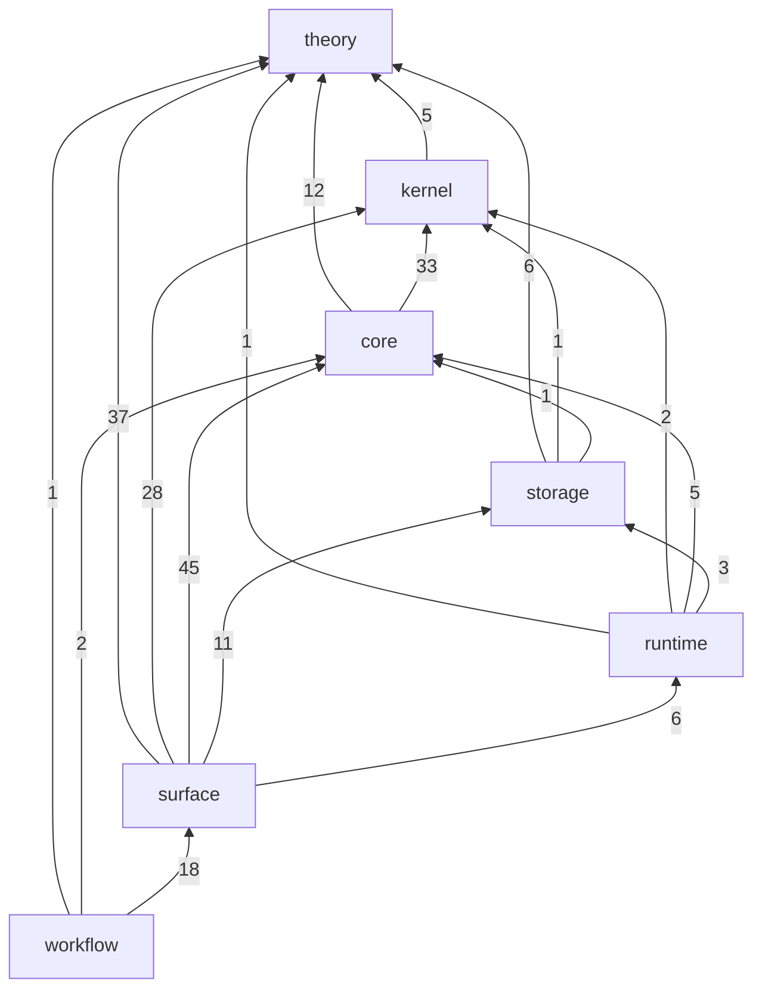

# Ledgers

The language surface and its features, each checked by the gates. The syntax ledger is enumerated by the toolchain from its own grammar and never edited by hand; the features ledger is a table written by hand as features land; the exemplars are small sources written by hand and verified against the ledgers.

## Files

- `syntax.md`: the syntax ledger, for reading. Every rule of the built-in grammar, grouped by sort: its form spelled from its tiles and holes, its precedence group, node kind, admission and highlight roles, each committed rule linking its exemplar; then the internal rules, which no source molds, each with its reason, and every registered attribute with its payload and exemplar. The header names the grammar's fingerprint.
- `syntax.json`: the same rows, for machines. Each form is a tree whose tiles carry the mold the grammar's build assigned them, their tile kind, their spelling and their role; one rule or attribute per line.
- `features.sql`: the features ledger, the `sqlite3` dump of one table of what gandr implements, partly implements, plans and declines, each row with its evidence: the schema first, then one `INSERT` per row in `id` order. `features.db` is built from it and never tracked.
- `crates.dot`: the per-crate map, one node per crate, clustered by category, each concern drawn as a dashed overlay through its crates; § Map below draws the category map, in the layering order of `crates/README.md` § Layering. `mise run ledger:crate-map` generates both from `cargo metadata`. `mise run check:crate-map` fails while either is stale, while a crate lies outside the layering's categories, or while an edge points to a category listed after its own. A change that adds a crate or an edge between two crates regenerates the map in the same commit, so its diff shows the new edge.
- `concerns.sql`: a concern is an interface that cuts across crates. The file records each concern and its sites, each site a crate and module that defines, implements or consumes the concern. For `sharing`, each site also names the descent datum its mechanism glues: positions, cover, compatibility, gluing and the certificate the kernel replays. `mise run check:crate-map` also fails while a concern has no site, while a site names a module its crate lacks, or while a concern's interface trait is implemented outside a test where no site names it. Edit a row by hand, then run `mise run ledger:concerns` to normalize the file.
- `purposes.sql`: says what each library's public items, modules and root are for, with a naming and a documentation verdict, its schema defining each column. `mise run purposes:list <crate>` prints a crate's entries beside their rows; `mise run check:purposes` fails while a rowed crate has an item with no row, a row names no item, or an entry carries a concern that no site of it in `concerns.sql` covers. A site covers its module, the modules below it and their items; a site at the empty module covers its whole crate.
- `positions.sql`: classes each struct of the kernel and storage crates whose one field is an unsigned integer or a byte array, outside their tests, and each such struct of the core term arena, whose ids a session's report holds: there a place, a count or a digest takes a name. A row names the key, the name or the byte form that writes the struct, and its class: `kept`, a place inside a piece that its content names; `owed`, a place relative to an order of admission or of mints, with the issue whose unit removes it; `local`, a place that none writes; `none`, no place. Its schema defines each column. `mise run check:positions` fails while such a struct has no row or a row names none, and `mise run ledger:positions` normalizes the file.
- `shared.sql`: classes what a write does to each structure that a freeze, a fork or a hand-on shares in the kernel's session. Its `shared` table holds a row for each field that holds an `Arc`, alone or in an `Option`, a `Maybe` or a `Vec`, in a struct or an enum of a kernel crate or of the fork crate, outside their tests. The class is `chunked`, a write copies at most one chunk; `layered`, a fork adds a layer and a read walks the layers; `copied whole`; `grows with the module`, what each clone, check or join holds or reads grows with the module; or `read only`. A `copied whole` or a `grows with the module` row names the issue whose unit moves it. Its `stated` table names the items that no field shows: an id that takes a width, a structure that takes the arena's region, and a window of the schedule, each with its unit. The structures are cases of the picture of `storage-metatheory-programme.md` § storage-programme-memory-model-reading: a copy halts at the next boundary. Its schema defines each column. `mise run check:shared` fails while such a field has no row, a row names none, or a stated row names an item that its file does not declare. Edit a row by hand, then run `mise run ledger:shared` to normalize the file.
- `references.sql`: maps each source the documentation cites to its module: a `# References` line, `` - `<key>` — <role>: <what it decides> ``, or a DOI or arXiv locator not yet keyed. Its `work` rows state the year a cited work appeared and its newer work by the same authors; a work cited by a DOI needs one, since a DOI carries no year. Its `fidelity` rows, written by hand, record each site the citation refresh has read against the newest work stating what it builds: the work it replaced, the verdict, the follow-up, the works traced and the anchor. `mise run ledger:references` writes it, `mise run refs:read` records a reading, `mise run refs:list` shows readings gone stale, and `mise run check:references` fails while it is not the tree's, while the crates or the corpus cite a work older than the citation window `.config/references/window.toml` opens, at a site none of its entries covers, or while a recorded site breaks its record.
- `corpus/ledger/syntax/<rule>.gandr`: one exemplar per committed rule, opening with a `///` comment naming the rule; it holds one item holding a tile of the rule, two for a glyph rule, beside any declaration its items name.
- `corpus/ledger/attributes/<name>.gandr`: one exemplar per attribute, opening with a `///` comment naming it; it lowers with the attribute filed on the item it decorates, beside any declaration its payload names.
- `corpus/ledger/features/<feature id>.gandr`: a focused program for a row no corpus fixture shows, named by the row's id, opening with a `///` comment naming it. Every declaration states `checks`, `runs` or `normalizes` and settles; `owes` and `refuses` are findings there. A row a fixture shows names that fixture, never a copy.
- `corpus/ledger/diagnostics/<name>.gandr`: one per refusal name no form qualifies and per reserved or unadmitted boundary, refused with it; a name without one has a row of the gate's owed table, its reason or issue.

`ledger/` is a fixture root, so an exemplar states what the checker makes of its form, `refuses` included where the checker does not reach it yet, its comment naming the issue that would settle it.

How each row is read off the grammar, the notation a form is spelled in, why a rule is internal and what an exemplar must hold are in the `ledger` module of [`gandr-workflow-ledger-tasks`](../crates/workflow-ledger-tasks/src/ledger.rs).

## Map

An arrow is one category's dependencies on another, labelled with the count of `[dependencies]` edges between their crates. Dev and build dependencies are not counted.

<!-- crate-map:begin -->

<!-- crate-map:end -->

## Presented spaces

gandr reads every object it checks as a presented space: a finite set of cells, each cell with a boundary of lower cells and data on it. Five operations act on a presented space, and each operation emits evidence.

| Operation | What it does | Crates that hold it today |
| --------- | ------------ | ------------------------- |
| present | writes the cells and their faces | `theory-computads`, `theory-circuit-algebras`, `theory-sites`, `theory-shapes` |
| glue | checks each piece alone, checks agreement where pieces overlap, and assembles the pieces once | `kernel-core`, `core-incremental`, `storage-store`, `theory-cellular-sheaves` |
| collapse | keeps the critical cells and the pairing of the cells that cancel | `theory-discrete-morse`, `theory-coherent-resolutions`, `core-nbe` |
| measure | gives each cell a value in an algebra and propagates the value | `theory-ordered-algebras`, `theory-probability`, `theory-dynamic-graphs`, `core-term` |
| replay | checks the evidence that the other four operations emit | `kernel-core` |

Gluing and collapse claim identity: two names denote one object. Only replay claims validity.

Two crate families present a space. The cell family presents a space by its cells and faces. The algebra family presents a space by its algebra of observations, and it holds the exact quantities. Finite Stone duality makes the two presentations of a finite space equivalent.

| Family | Presents a space by | Crates |
| ------ | ------------------- | ------ |
| cell | its cells and their faces | `theory-graded-posets`, `theory-cellular-sheaves`, `theory-discrete-morse` |
| algebra | its algebra of observations | `theory-stone-duality`, `theory-ordered-algebras`, `theory-exact-reals`, `theory-probability` |

Each crate above has one place in the frame.

| Crate | Place |
| ----- | ----- |
| `core-incremental` | glue: the checkpoints of incremental checking |
| `core-nbe` | collapse: normal forms |
| `core-term` | measure: grades on types |
| `kernel-core` | glue by its descent skeleton, and replay |
| `storage-store` | glue with identity on overlaps |
| `theory-cellular-sheaves` | the cell family's glue: sections that agree where the cells of a cover overlap, and cohomology through a tower of levels |
| `theory-circuit-algebras` | present: circuit wirings |
| `theory-coherent-resolutions` | collapse: critical pairs |
| `theory-computads` | present: descriptions elaborated into cells |
| `theory-discrete-morse` | the cell family's collapse: acyclic matchings, their check and their critical cells |
| `theory-dynamic-graphs` | measure: the tropical potentials of universe levels |
| `theory-exact-reals` | the algebra family's exact reals |
| `theory-graded-posets` | the cell family's present: a finite poset with its cells as data, and its lattice of subcomplexes |
| `theory-ordered-algebras` | the algebra family's measure: ordered semirings and their law checks |
| `theory-probability` | the algebra family's measure: finite distributions with exact weights, and independence as the separation of supports |
| `theory-shapes` | present: finite shapes and their face formulas |
| `theory-sites` | present: the site of shapes |
| `theory-stone-duality` | the algebra family's present: a finite space by its lattice of observations |

The tables name only crates that this workspace holds, never a planned crate.

## The features ledger

| Column | Holds |
| ------ | ----- |
| `id` | the row's slug, lowercase words joined by `-`, never renamed |
| `area` | the chapter a manual would put it in: `types`, `identity`, `recursion`, … |
| `name`, `line` | the heading, and one sentence saying what the feature is |
| `parent` | the row this one nests under, in the same area |
| `status` | `implemented`, `partial`, `planned` or `declined` |
| `notability`, `compared_to` | `ordinary`, `notable`, `uncommon` or `unique`; the last two say against what |
| `crate` | the owning crates, directory names under `crates/`, or a `contrib/` path |
| `corpus` | witnesses: a fixture path under `corpus/`, or a test file from the root, `::item` naming a test in it |
| `exemplar` | the program showing the row: a `model/` or `strict/` fixture from the root, or `corpus/ledger/features/<id>.gandr`; never `pathological/`. `crate-tests`: a mechanism no program shows, its evidence the tests in `corpus`; refused where `corpus` names a fixture |
| `issue` | tracker issues, `#n` separated by spaces |
| `since` | the pull request that landed an implemented or partial row, or the commit before pull requests |

A row's status needs its evidence, and the table's constraints refuse one without it: an implemented row a `crate` or a `corpus` witness; a partial row that and an open issue or a `pathological/` witness of what it still refuses; a planned or declined row the issue that records the plan or the decision. An implemented or partial row names an exemplar unless its area's evidence is crate tests: `editor`, `workflow`, `storage`, `tooling`, `incremental`, `algorithms`, `machine`, `staging`, `kernel`, `conversion`, `runtime`, `syntax`, `printing`, `diagnostics`, `rewriting`, `corpus`.

To edit it: `mise run ledger:build`, change `features.db` with `sqlite3`, `mise run ledger:dump`, and commit `features.sql`.

## Commands and gates

| Command | Does |
| ------- | ---- |
| `mise run ledger:syntax` | regenerates `syntax.md` and `syntax.json` with the worktree's own build, never the default toolchain's |
| `cargo run --package gandr-lang -- ledger exemplars corpus/ledger` | verifies every exemplar, printing `<file>: <fault>` for each that does not hold |
| `cargo run --package gandr-lang -- test corpus/ledger` | settles every exemplar |
| `mise run check:syntax-ledger` | regenerates both ledger files into a temporary directory through `ledger:syntax` and fails, printing the difference, while either differs from the committed file |
| `mise run check:syntax-exemplars` | fails while a committed rule, an attribute or a refusal has no exemplar or owed row, a file names none, an exemplar does not show what it names, or a features exemplar states `owes` or `refuses` |
| `mise run check:exemplars` | fails while an exemplar leaves a declaration unsettled |
| `mise run ledger:build`, `mise run ledger:dump` | build `features.db` from `features.sql`, and dump it back |
| `mise run check:ledger` | fails while `features.sql` breaks a constraint or is not its own re-dump, a `parent` names no row, a named path does not exist, a features exemplar is named by no row, or a language feature names no exemplar |

`mise run check` runs every gate and CI runs them on every change. A change to the grammar or to the attribute registry regenerates the ledger and updates the exemplars in the same commit; a change that lands, changes or retires a feature edits its row of `features.sql` in the same commit.

## Crate READMEs

A crate's `README.md` is its only document: an overview and conceptual entry that links into the crate's `src/lib.rs` `//!` docs and the owning module, where mechanism, invariants and specification detail live and `check:doc` builds them; a decision's choice, alternatives and reversal live in its pull request and issue. A crate carries no `docs/` directory and no changelog of its own. A behavioural floor or a deferred-row ledger is a tracking issue, linked from the README once; a measurement or a report belongs to neither. `check:markdown` refuses tracked markdown outside its README allowlist, and a README over its budget in `sizelint.toml`.

Every crate README follows one order. A section is present when the crate has content for it.

1. `# <package>`, followed by one sentence stating what the crate is.
2. A table of contents linking every section below.
3. `## Synopsis`: three paragraphs, each opening with a bold word. **What.** names the thing the crate is, **Why.** the need it answers, and **How.** the mechanism, named concretely. The prose is dense, technical and in the present tense, and carries no history.
4. `## References`: one entry per key the crate's modules cite, `` - `<key>` — <role>: `` then the full title, the authors, the venue, the date, a stable identifier (DOI, ISBN, arXiv, HAL) and one clause on what the crate takes from it.
5. `## Provided features`: what the crate provides, as items.
6. `## Expected features`: what the crate requires of its consumer or its environment to be useful, such as a digest function, a store implementation, a spawner, a target requirement or a specification facade's `cfg`. Absent or planned work is not listed here.
7. `## Examples`: runnable usage and the command that runs the crate's tests.
8. `## Where the detail lives`: the modules whose rustdoc states each mechanism and decision, as a table or one sentence.
9. `## License`: `Apache-2.0 WITH LLVM-exception`, the workspace licence, whose text is at the repository root.
